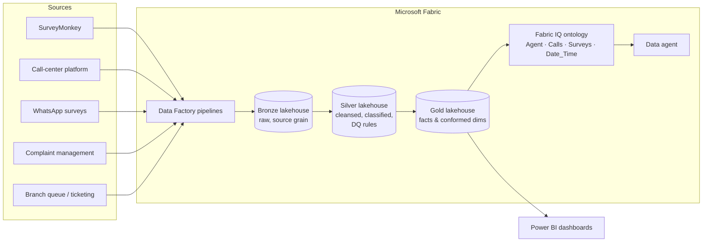
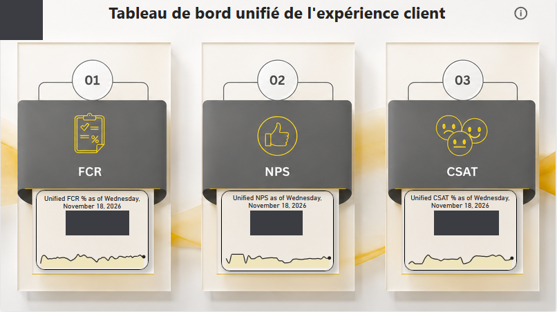
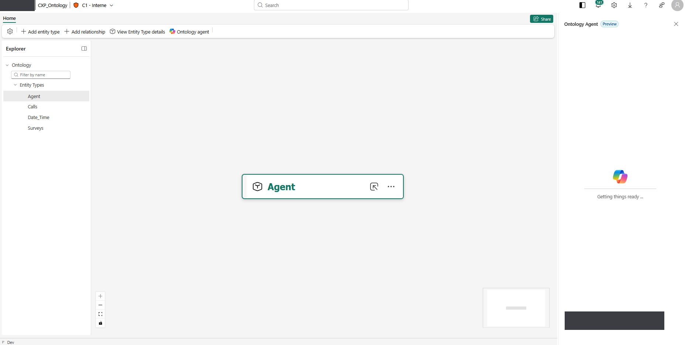
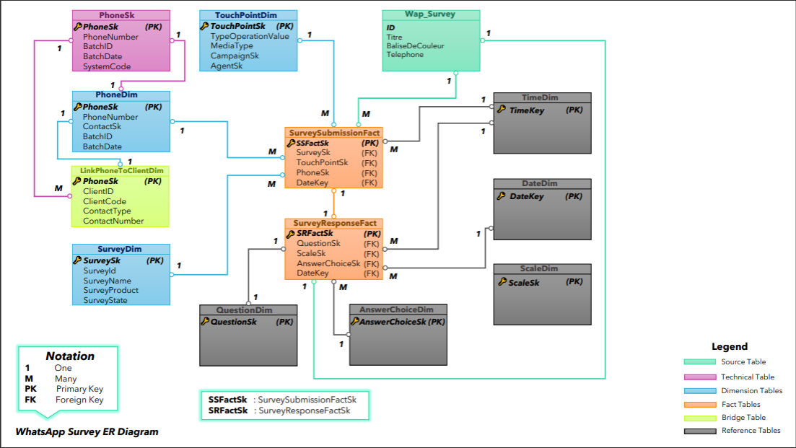
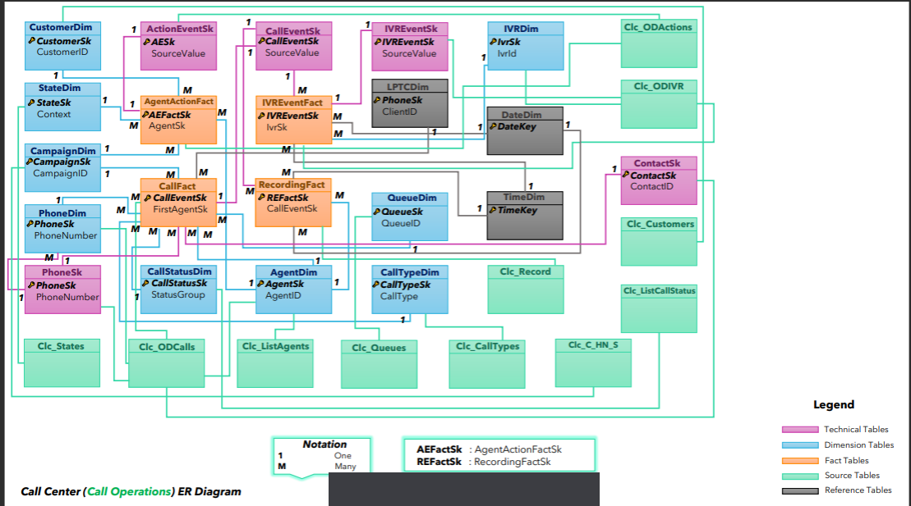

# Customer Experience 360

> An enterprise customer-experience analytics platform on **Microsoft Fabric**. It brings survey, call-center, WhatsApp, complaint and branch-queue data into a medallion lakehouse and a Kimball dimensional model, publishes unified CX dashboards (CSAT, NPS, FCR and more), and adds a **Fabric IQ ontology** so a data agent can answer business questions in natural language.

`Microsoft Fabric` · `Data Factory` · `Lakehouse (Bronze/Silver/Gold)` · `Kimball dimensional modeling` · `Power BI` · `Fabric IQ Ontology` · `Fabric data agent` · `SurveyMonkey`

---

## Overview

Customer-experience signals at a bank are spread across systems: post-call surveys, SurveyMonkey campaigns, WhatsApp surveys, the contact-center platform, the complaint-management system and branch queue-ticketing. Each team reported its own numbers, often with different definitions.

**Customer Experience 360** gives one governed foundation for all of it:

- a **medallion architecture** (Bronze, Silver, Gold lakehouses) fed by **Data Factory** pipelines,
- a **conformed dimensional model** in which every channel shares the same survey, question, channel, touchpoint, date and time dimensions,
- a **semantic layer that interprets each question once**, during ingestion, instead of in every report,
- **Power BI dashboards** for unified CX, the call center, complaints and queue management,
- a **Fabric IQ ontology** (entity types such as *Agent*, *Calls*, *Surveys*, *Date_Time*) that gives a data agent the business context it needs for generative-AI use cases.

## Problem and goals

**Problem**
- CX data lived in separate channel-specific structures, so the same KPI could be calculated differently in different reports.
- Survey questions, scales and answers (often in French, for example *Très satisfait*) were interpreted inside individual Power BI measures, which repeated logic and invited errors.
- Free-text feedback was hard to combine with numeric scores.
- Business users and AI tools had no shared vocabulary for the data.

**Goals**
- One analytical model that serves all CX channels, now and in future.
- Consistent definitions of CSAT, NPS, CES, FCR and related KPIs across the organization.
- A dataset ready for both BI and AI.
- Built-in data-quality rules in the Silver layer.

## Solution and workflow

**The analytical journey for survey data**

`Raw survey response → Question classification → Scale identification → Answer standardization → Submission consolidation → CX KPI calculation → Enterprise CX reporting`

1. **Bronze:** raw responses land at their atomic grain. For SurveyMonkey that is one row per *survey × submission × question*.
2. **Silver:** question text is classified by CX intent (CSAT, NPS, CES, FCR, Value, Perception, Text, Context). The response scale is detected (1–5, 1–10, 0–10 NPS, Yes/No, none). Raw answers are mapped to numeric values (for example *Très insatisfait → 1 … Très satisfait → 5*, *Oui → 1 / Non → 0*). Data-quality rules are applied.
3. **Gold:** facts and conformed dimensions are built for reporting and AI.

## Data model

The model is a **Kimball constellation**: several fact tables share conformed dimensions.

| Table | Grain / purpose |
|---|---|
| `SurveySubmissionFact` | One row per survey × submission: channel, touchpoint, date/time, answered-question count, aggregated CSAT, NPS class, source system, ETL batch |
| `SurveyResponseFact` | One row per submission × question: question, scale, answer choice, numeric answer or `CommentText` |
| `SurveyInviteFact` | One row per invitation, for future invite-to-response conversion analysis |
| `QuestionDim` | **The semantic core.** CX domain plus flags `IsCSAT`, `IsNPS`, `IsCES`, `IsFCR`, `IsValue` |
| `ScaleDim` | Allowed min/max per scale type |
| `AnswerChoiceDim` | Translation from raw text answers to analytical numeric values |
| `SurveyDim`, `ChannelDim`, `TouchPointDim`, `DateDim`, `TimeDim` | Conformed context shared by all channels |

The call-center model adds `CallFact`, `IVREventFact`, `AgentActionFact` and `RecordingFact` with agent, queue, campaign, call-type, call-status and IVR dimensions. The full design rationale is in [`docs/data-model.md`](docs/data-model.md).

**Data-quality rules (Silver)**
- A question can't carry conflicting CX metric flags, and its CX domain must agree with its flags.
- Numeric responses need a valid `AnswerNumeric`, text responses need `CommentText`, and no response is both.
- Every response references a valid submission, and every dimension key resolves.

## KPIs and dashboards

| Dashboard | KPIs |
|---|---|
| Unified CX | FCR %, NPS, CSAT % (trend over time) |
| Call center | CSAT, NPS, FCR, ASA, total calls, lost calls, abandon rate, AHT, service level, survey response rate; calls by category, answered vs lost, occupancy and volume by agent |
| Complaints | Total / closed / open / recurring / untreated complaints, recurring rate, adjustment and reversal amounts and volumes, complaints by type and by branch |
| Queue management | Average wait time, average service time, total / served / unserved / trashed tickets, FCR, waiting time by branch, service time by service, ticket volume by hour |

**KPI rules used in the model:** CSAT is aggregated from standardized `AnswerNumeric` on questions flagged `IsCSAT`. NPS classifies 0–10 answers as Detractor (0–6), Passive (7–8) or Promoter (9–10). See [`samples/nps_classification_example.sql`](samples/nps_classification_example.sql).

## Business context layer (ontology) and data agent

A **Fabric IQ ontology** (`CXP_Ontology`) models the CX domain as business entity types (*Agent*, *Calls*, *Surveys*, *Date_Time*), each bound to lakehouse data. Fabric IQ builds a graph model and a supporting lakehouse from it. The ontology gives a **data agent** the business meaning behind tables and columns, so natural-language questions ("Which agents have the lowest CSAT this month?") are answered from governed data with consistent definitions.

Open-ended feedback is kept as `CommentText`, ready for sentiment analysis, topic and complaint classification, pain-point detection and AI summarization.

## Business value

- **One version of the truth:** each KPI has one definition across every channel and report.
- **Faster reporting:** question interpretation happens once in the pipeline, not in every measure.
- **Scalable:** a new channel plugs into the existing conformed dimensions.
- **AI-ready:** the ontology and preserved free text are the base for conversational analytics and AI-driven CX insights.

## Screenshots

| Unified CX dashboard | Fabric IQ ontology |
|---|---|
|  |  |
| Unified FCR / NPS / CSAT tiles (values hidden) | `CXP_Ontology` with entity types and the Ontology agent |

| WhatsApp survey ER diagram | Call-center ER diagram |
|---|---|
|  |  |

## Security, privacy and limitations

- No customer, agent or survey data is included. Dashboard values are hidden, and the agent and branch screenshots are excluded.
- Phone numbers and contact identifiers are linked through technical and bridge tables (`PhoneSk`, `LinkPhoneToClientDim`), which keeps personal identifiers separate from the analytical facts.
- `SurveyInviteFact` is designed for when invitation data becomes available.
- The ontology is built on Fabric IQ, which is in preview, so its feature set may change.

## My role

I designed the CX survey enterprise data model (dimensional design, semantic question classification, scale and answer standardization, data-quality rules), built the medallion pipelines and the Fabric IQ ontology, and contributed to the Power BI dashboards.

---
Client name, logos, KPI values, employee names and branch data have been removed.
